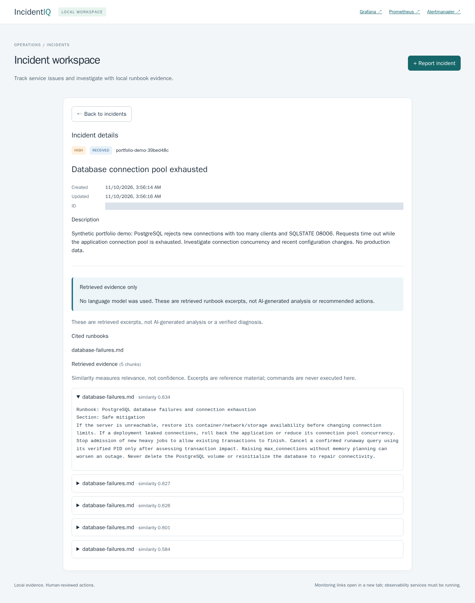
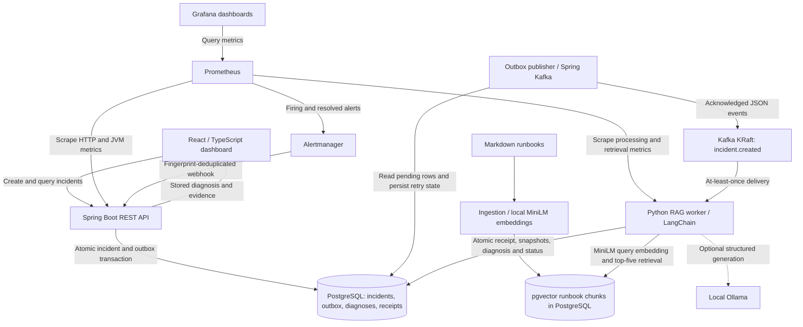

# IncidentIQ

**Local incident monitoring with evidence-backed investigation.** IncidentIQ turns manual reports and monitoring alerts into durable incidents, retrieves relevant runbooks, and optionally generates cited diagnoses with a local language model. It connects detection, asynchronous processing and an incident dashboard without a hosted AI service.

The default is **retrieval-only**: original runbook excerpts are clearly distinguished from AI-generated analysis. **AI recommendations require human review. No remediation commands are executed.**



*Actual React dashboard captured from running Docker Compose services on November 9, 2026 (America/Chicago; timestamps in the image are UTC). One new synthetic incident was submitted through the UI and processed by the real pipeline; no responses were mocked. The synthetic UUID is masked, and no existing incident list or credentials are shown. [Capture provenance](docs/images/capture.json) · [Portfolio verification](docs/portfolio/VERIFICATION.md).*

## What it implements

- **Incident workflow:** validated Spring Boot REST API, server-side filters/pagination, manual reporting, periodic refresh, loading/error states and accessible React controls.
- **Durable delivery:** incident + transactional outbox commit together; a separate publisher retries Kafka delivery. The worker deduplicates event IDs and commits offsets only after durable processing or quarantine.
- **Real local retrieval:** ten Markdown runbooks, idempotent ingestion, 384-dimensional MiniLM embeddings and pgvector cosine search. Five retrieved chunks are stored as immutable evidence snapshots with filenames and similarity scores.
- **Optional RAG generation:** LangChain + local Ollama produce structured likely causes, investigation steps, remediation suggestions and validated citations. Invalid outputs, missing evidence and unavailable models fail closed; there is no silent hosted-provider fallback.
- **Automatic detection:** Prometheus HTTP 500, p95 latency and availability alerts reach Alertmanager and the incident API. Fingerprints deduplicate active alerts; resolved notifications update incident state. Internal processing routes are excluded from error/latency rules to avoid recursive alerts.
- **Observability:** Actuator/Micrometer and Python metrics, bounded labels, persistent Prometheus/Grafana storage and a provisioned 16-panel dashboard.

## Architecture



The API owns Flyway migrations; the publisher and worker use internal Docker networking. `incident.created` is the implemented event path. The initialized `incidents.raw` and `incidents.analyzed` topics are legacy/reserved, not additional implemented processing stages. PostgreSQL and pgvector share one database service. See [transaction boundaries and delivery guarantees](docs/architecture.md).

### Technology stack

| Area | Technologies |
|---|---|
| API / publisher | Java 21, Spring Boot 3.5.16, Spring Web, JPA, Jakarta Validation, Flyway, Spring Kafka |
| Persistence / events | PostgreSQL 16, pgvector 0.8.7, Kafka 3.9.1 in single-node KRaft mode |
| Retrieval / optional AI | Python 3.12, LangChain 0.3.30, sentence-transformers 5.6.0, CPU Torch 2.10.0, all-MiniLM-L6-v2; optional Ollama |
| Dashboard | React 19, TypeScript, Vite 6, nginx |
| Operations / verification | Docker Compose, Prometheus, Grafana, Alertmanager, JUnit, pytest, Playwright, k6, Trivy |
| Future infrastructure | Kubernetes/Kustomize, modular Terraform for Azure, Azure DevOps YAML — **static validation only** |

Exact dependency pins and the actual resolved locks are in [api/pom.xml](api/pom.xml), [worker requirements](worker/requirements.txt), [worker lock](worker/requirements.lock) and [frontend lock](frontend/package-lock.json).

## Run locally

Use a WSL/Linux shell with Docker Engine or Docker Desktop's WSL integration, Docker Compose and Bash. Java, Maven, Node and application Python packages are built inside Docker; **no host Java or Maven is required**. Python 3 is needed only for the optional host verification helpers. The first build downloads public images, packages and the pinned MiniLM weights; application data and inference remain local.

From the repository root:

```bash
# Preserve an existing configuration. On a new checkout, create local settings:
test -f .env || cp .env.example .env
# Review .env locally; keep LLM_PROVIDER=none for the default demo.
docker compose --profile observability config --quiet
# Explicitly build shared images before publisher/ingestion startup:
docker compose --profile observability build api worker frontend
docker compose --profile observability up -d --wait
docker compose --profile observability ps -a
```

Keep `.env` ignored. Its example credentials are local-development placeholders; retain existing credentials when reusing initialized data. Editing a password in `.env` does not rotate an existing PostgreSQL/Grafana volume's credentials. `kafka-init` and `runbook-ingest` are one-shot services: a successful exit is expected. Builds can take several minutes on a small CPU machine.

| Service | Local address |
|---|---|
| React dashboard | [localhost:5173](http://localhost:5173) |
| Spring Boot API / health | [localhost:8080/actuator/health](http://localhost:8080/actuator/health) |
| Grafana | [localhost:3001/d/incidentiq-overview](http://localhost:3001/d/incidentiq-overview) — admin password from your ignored `.env` |
| Prometheus | [localhost:9090](http://localhost:9090) |
| Alertmanager | [localhost:9093](http://localhost:9093) |
| PostgreSQL / Kafka | `127.0.0.1:55432` / `127.0.0.1:9092` |

Ports above are the defaults and bind to loopback. Containers use `postgres:5432`, `kafka:29092` and the nginx `/api` proxy rather than host ports. Stop while retaining containers and volumes with `docker compose --profile observability stop`. Do not delete persistent volumes to troubleshoot startup.

### Try the demo

1. Open the dashboard and select **Report incident**. Use service `portfolio-demo`, severity `HIGH`, title `Database connection pool exhausted`, and describe PostgreSQL rejecting connections with `too many clients` / `SQLSTATE 08006`.
2. Open the incident. It starts `PENDING`, then normally becomes `RECEIVED`. Inspect the five stored chunks, source filenames and similarity scores. **RETRIEVAL_ONLY means no language model was used**; similarity is relevance, not confidence.
3. Open Grafana and Prometheus to inspect actual API/worker activity. Alertmanager can be empty when nothing is firing; metrics and alert thresholds are intended for this local demo.
4. Optionally run the existing alert smoke helper below. It temporarily enables development-only failure/latency simulators and stops/restarts the worker, then restores the default configuration. It creates and retains synthetic incidents/quarantine evidence; it does not delete data.

```bash
# Optional: real failure -> Prometheus -> Alertmanager -> outbox/Kafka -> diagnosis
python3 scripts/smoke-auto-detection.py --skip-build
```

For direct HTTP use, the API supports `POST /api/incidents`, paginated `GET /api/incidents`, `GET /api/incidents/{id}` and `GET /api/incidents/{id}/diagnosis`. Creation returns HTTP 201; diagnosis lookup can return 404 while asynchronous processing is pending. [API evidence](docs/api-verification.md) · [Current end-to-end regression](docs/security/VERIFICATION.md).

### Optional local Ollama

Ollama is **not required** for the default demo. The explicit [Compose override](compose.ollama.yaml) runs a CPU-only local service with a separate model volume and private Docker DNS. Model downloads are explicit, never automatic. Follow [setup and actual-model verification](docs/ollama-verification.md); restore the base worker afterward to keep `LLM_PROVIDER=none`.

Real `qwen3:0.6b` generation was tested. In the latest security regression, database and memory incidents produced stored generated diagnoses in **53.159 s / 30.226 s** end to end; the database case needed one timeout/retry. A Kafka answer was rejected and durably quarantined rather than accepted as safe advice. Missing-model, timeout, invented-citation and prohibited-offset tests passed. These are sampled transport/guard checks, **not proof of general semantic grounding**. [Latest measured results and limitations](docs/security/VERIFICATION.md).

## Measured performance and recovery

### Retrieval-only benchmark — November 7, 2026

Dockerized k6 1.3.0 on WSL: Intel Core Ultra 5 225U, 14 logical CPUs, approximately **7.2 GiB RAM**. The async worker was capped at **one CPU / 1024 MiB**. This is one bounded local trial on the **earlier `f8912f0` application baseline**, before the security dependency updates; it was not rerun for this documentation milestone. Ollama was excluded.

| Workload | Observed throughput | Average latency | p95 | p99 | Failures |
|---|---:|---:|---:|---:|---:|
| API reads: 4 VUs, 20 s, 1,371 requests | 65.80 requests/s | 7.36 ms | 14.53 ms | 40.53 ms | 0% |
| API creates: 2 VUs, 40 requests | 17.02 requests/s | 15.85 ms | 21.35 ms | 22.28 ms | 0% |
| Separate Kafka/retrieval batch: 60 events | 6.19 events/s | 2,730.88 ms | 5,204.01 ms | 5,369.19 ms | 0 / 60 |

HTTP throughputs include think time; publisher/worker were stopped during API measurements. Async latency measures broker append to observed committed diagnosis, including queueing, embeddings/vector retrieval and polling delay; it excludes HTTP submission. The batch drained in 9.6974 s with 60 diagnoses/300 snapshots. Small samples, warm corpus, one host/broker/partition, resource quotas and a fixed incident shape limit the result. **These are not maximum-capacity, production-SLO or Ollama-throughput claims.** [Raw measurements and conditions](docs/benchmarks/RESULTS.md) · [Reproduce and retain/clean up test data safely](docs/benchmarks/README.md).

### Fault recovery — latest security regression, November 8, 2026 UTC

Eight scenarios ran in a private Docker project with separate PostgreSQL/Kafka storage, database, topic and consumer group. Retrieval-only mode and real local embeddings were used.

| Injected condition | Observed case interval |
|---|---:|
| Worker killed before DB commit / after DB commit | 34.514 s / 35.825 s |
| Duplicate events plus consumer join/leave | 50.129 s |
| Kafka unavailable / PostgreSQL unavailable | 81.930 s / 22.216 s |
| Publisher killed after Kafka acknowledgement | 111.055 s |
| Stale consumer membership / malformed event retained | 27.525 s / 12.478 s |

Final accounting: **10 valid events, 10 diagnoses, 50 immutable snapshots, seven duplicate handlings, one durably quarantined poison event, committed/end offsets 15/15, zero observed valid-event loss in this sample**. Publisher recovery deliberately produced Kafka replay. `UnknownMemberIdError`/`CommitFailedError` caused a fail-closed restart and safe deduplication; the original naturally occurring benchmark trigger remains unresolved.

Intervals include case-specific startup/rejoin/retry/observation work, not a uniform recovery SLA. One partition cannot demonstrate parallel processing or multi-broker failover; long outages, disk/WAL loss and Ollama-under-fault behavior were not verified. **Delivery is at least once, not exactly once.** [Latest complete observations](docs/security/VERIFICATION.md) · [Fault methodology and earlier runs](docs/faults/README.md).

## Testing and evidence

Latest complete application regression, **November 8, 2026 UTC**: **64 Java tests, 77 Python tests, seven frontend tests, 14 browser checks, 55 infrastructure/security helper tests and eight real fault scenarios passed**. Additional checks covered 12 real HTTP requests, 16 Grafana panels, all three actual alert flows and the separate actual Ollama positive/negative cases. Ordinary image builds skip database-specific cases; the explicit full suites use real PostgreSQL and MiniLM. LLM unit mocks and UI-only fixtures are distinguished from actual model runs in the reports. These historical counts are not a claim that every suite ran again for the portfolio edit.

Reproduce the isolated Java/Python/frontend stages serially on a small host:

```bash
bash ci/bootstrap.sh basic
bash ci/test.sh java
bash ci/test.sh python
bash ci/test.sh frontend
# Existing local services required; retains synthetic incidents:
bash scripts/test-dashboard.sh
```

| Evidence | What it establishes |
|---|---|
| [Latest verification](docs/security/VERIFICATION.md) / [structured results](docs/security/verification.json) | Security-update builds, full regressions, real retrieval, fault recovery and actual Ollama |
| [API](docs/api-verification.md), [event delivery](docs/event-verification.md), [retrieval](docs/retrieval-verification.md), [RAG](docs/rag-verification.md) | Historical implementation milestones and transaction/offset behavior |
| [React dashboard](docs/dashboard-verification.md), [monitoring](docs/monitoring-verification.md), [automatic alerts](docs/automatic-detection-verification.md) | Real browser, datasource and alert-webhook tests; older counts are milestone-specific |
| [Ollama](docs/ollama-verification.md) | Initial grounding failure, narrow repair and sampled actual-model tests |
| [Portfolio checks](docs/portfolio/VERIFICATION.md) | Screenshot provenance, README links, diagram and setup validation for this documentation milestone |

## Security status: 50 critical/high occurrences remain

The **November 8, 2026 UTC** comparison used Trivy **0.69.3** and the same frozen vulnerability/Java databases. It reduced critical/high finding occurrences **144 → 50 (65.3%)**, without suppression.

| Runtime image | Remaining critical | Remaining high |
|---|---:|---:|
| API / publisher | 2 | 0 |
| Worker / ingestion | 0 | 48 |
| Frontend | 0 | 0 |
| **Total** | **2** | **48** |

These **50 occurrences represent 14 distinct CVEs**, not 50 independently verified exploits. Two Spring MVC occurrences need a compatible public Spring/Boot migration; one legacy LangChain loader needs a coordinated major upgrade; 47 Debian source-package occurrences lack a Debian 13 fixed version in the frozen snapshot. Some affected features are not used by this application, but reachability review is **not proof of non-exploitability**. Medium/low findings remain too. Zero frontend findings in that snapshot is not a zero-vulnerability guarantee, and other service/build images were outside that comparison.

[Every critical/high row, fixed versions, duplicates and deferrals](docs/security/TRIAGE.md) · [Risk analysis and scanner/database provenance](docs/security/README.md). The scan is historical, not a current-date rescan or production security certification. Keep credentials out of Git and treat incident text, runbooks and model output as untrusted data.

## Infrastructure status — what was actually verified

| Environment | Verified | Not verified |
|---|---|---|
| **Docker Compose** | Actual API, Kafka/outbox, PostgreSQL/pgvector, ingestion/retrieval, React, alerts, metrics and optional local Ollama flows | Production HA, independent external watchdog, general AI correctness |
| [Kubernetes / Kustomize](docs/kubernetes/README.md) | Rendering, schemas, cross-resource checks, probes and resource definitions; [17-resource local overlay validation](docs/kubernetes/VERIFICATION.md) | No cluster created or runtime smoke test; available RAM failed the conservative gate |
| [Azure Terraform](docs/azure/README.md) | Modular resource group/network, ACR, private AKS, managed identities/Key Vault references; [fmt, init -backend=false and validate](docs/azure/VERIFICATION.md) | No Azure authentication, plan/apply, paid resources or deployment |
| [Azure DevOps YAML](docs/ci/README.md) | Pipeline schema/policy checks and local build/test equivalents; [verification](docs/ci/VERIFICATION.md) | No organization pipeline execution, hosted task/cache/artifact verification, ACR publishing or AKS rollout; release remains disabled and fails closed |

The project is a local engineering portfolio, not a claimed cloud deployment. Existing volumes and PostgreSQL host port **55432** are preserved. [Agent/contributor guide](AGENTS.md).
